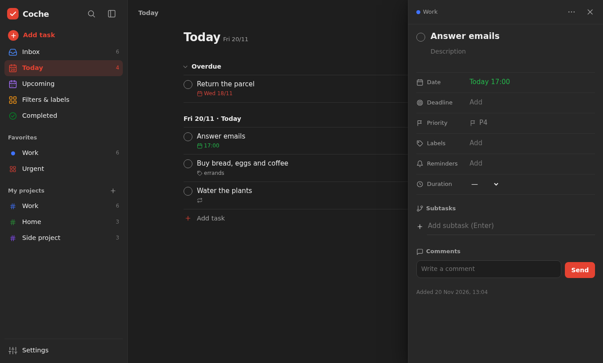

<div align="center">


# Coche

**Les fonctionnalités de Todoist, sur ton propre serveur.**
Ajout rapide en langage naturel · tâches récurrentes · projets, sections et sous-tâches · étiquettes et filtres · rappels · tableaux · statistiques et séries · une API compatible Todoist.

**Aucune dépendance** : la bibliothèque standard de Python et un fichier SQLite. Tourne sur un Raspberry Pi, un NAS, un conteneur LXC ou Docker.

[English README](README.md)



</div>

## Pourquoi Coche ?

- **On s'y sent comme dans Todoist.** Tape `Payer le loyer tous les 5 #Maison p1` : c'est compris. Glisse pour terminer, fais glisser pour réordonner, `Q` pour ajouter.
- **Rien n'est payant.** Rappels, échéances, durées, filtres et projets illimités, historique complet, flux calendrier.
- **Tes scripts continuent de marcher.** L'API `/api/v1` reprend celle de Todoist (v1) : change l'adresse de base d'un script Todoist et il fonctionne avec Coche.
- **Quitter Todoist prend un clic.** Colle ton jeton : projets, sections, étiquettes, tâches récurrentes, commentaires et historique récent arrivent.
- **Rien à maintenir.** Pas de Node, de Postgres ni de Redis, pas d'étape de build. Un processus, un fichier `coche.db` à sauvegarder.
- **Français et anglais**, dans l'interface comme dans la lecture des dates (« demain 14h », « every monday »).

## Démarrage rapide

### Avec Docker (conseillé)

```bash
git clone https://github.com/mathyouadr/coche.git && cd coche
cp .env.example .env          # choisis un mot de passe (COCHE_PASSWORD), vérifie COCHE_TZ
docker compose up -d
```

Coche refuse de démarrer tant que le mot de passe est celui de l'exemple. Ouvre ensuite **http://ton-serveur:8043** et appuie sur **Q** pour ajouter ta première tâche. Le [`docker-compose.yml`](docker-compose.yml) est prêt à l'emploi : volume pour les données, `.env` chargé automatiquement, vérification de santé, et un service [ntfy](https://ntfy.sh) optionnel (commenté) pour les rappels sur téléphone.

### Sans Docker

Il faut Python 3.10 ou plus (Linux, macOS ou Windows avec `py -m coche`).

```bash
git clone https://github.com/mathyouadr/coche.git && cd coche
python3 -m coche demo --lang fr   # facultatif : des tâches d'exemple
python3 -m coche                  # → http://127.0.0.1:8043
```

Sur iPhone ou Android, ouvre Coche dans le navigateur puis **Ajouter à l'écran d'accueil** : il s'ouvre en plein écran comme une vraie app.

### Depuis Todoist

**Réglages › Importer depuis Todoist**, colle ton jeton d'API (Todoist › Paramètres › Intégrations › Développeur), c'est fini. Ou bien :

```bash
TODOIST_API_TOKEN=xxxxxxxx python3 -m coche import-todoist
```

## Ajout rapide : l'antisèche

| Tu tapes | Tu obtiens |
|---|---|
| `Appeler maman demain 18h` | Demain à 18:00 |
| `Réviser maths jeudi 14h` | Jeudi prochain à 14:00 |
| `Payer le loyer tous les 5 #Maison p1` | Chaque mois le 5, dans *Maison*, priorité 1 |
| `Sport tous les jours ouvrés 7h @santé` | Du lundi au vendredi à 07:00 |
| `Arroser les plantes tous les! 3 jours` | 3 jours après chaque validation |
| `Rapport #Travail /T4 {vendredi}` | Projet *Travail*, section *T4*, **échéance** vendredi |
| `Dentiste 12/03 9h30 !1h` | 12 mars 09:30, **rappel** une heure avant |
| `Réunion jeudi 14h pendant 1h` | Avec une **durée** d'une heure |

Repères : `#Projet` · `/Section` · `@étiquette` · `p1`…`p4` · `{échéance}` · `!30min` / `!2h` / `!14h` (rappel).
Dates : aujourd'hui, demain, après-demain, lundi, lundi prochain, ce week-end, semaine prochaine, fin du mois, dans 3 jours, le 25, 25/12, 1er décembre, à midi, ce soir…
Récurrences : tous les jours, tous les lundis, tous les lundis et jeudis, toutes les 2 semaines, tous les 5, tous les 25/12, tous les jours ouvrés.

## Filtres

`aujourd'hui | en retard` · `p1 & #Travail` · `7 jours & !@attente` · `sans date` · `recherche: facture` · `date avant: lundi prochain`. Opérateurs : `|` ou, `&` et, `!` non, parenthèses.

## Rappels

Un ou plusieurs canaux au choix : **ntfy** (`COCHE_NTFY_URL`, le plus simple), **une commande** (`COCHE_NOTIFY_COMMAND`, qui reçoit le rappel en JSON sur son entrée standard) ou **un webhook** (`COCHE_WEBHOOK_URL`). Bouton de test dans les réglages.

## Configuration, API, thèmes

Toutes les variables (`COCHE_PASSWORD`, `COCHE_TZ`, `COCHE_BASE_PATH`, `COCHE_EXTRA_HEAD`…), la liste des routes de l'API compatible Todoist, les webhooks, le flux calendrier et la personnalisation par variables CSS sont détaillés dans le [README anglais](README.md#%EF%B8%8F-configuration).

## Licence

[MIT](LICENSE). Coche n'est pas affilié à Doist ni à Todoist.
