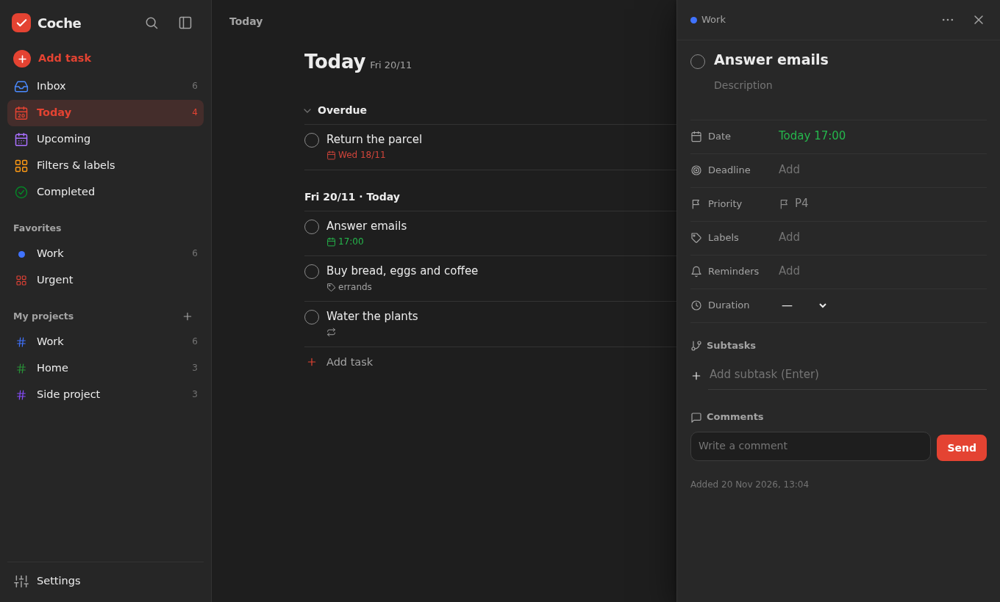
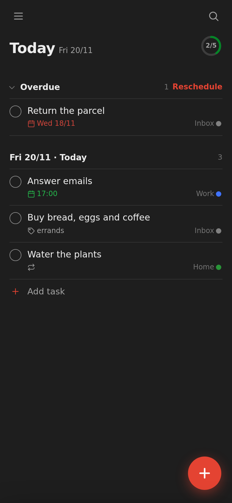
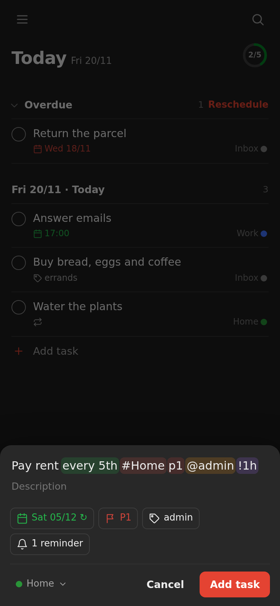
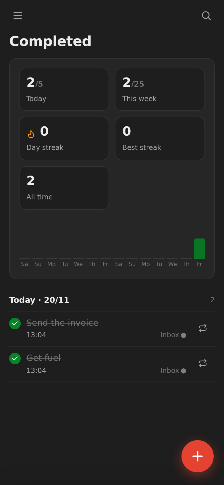

<div align="center">


# Coche

**The Todoist feature set, on your own server.**
Natural-language Quick Add · recurring tasks · projects, sections & subtasks · labels & filters · reminders · boards · stats & streaks · a Todoist-compatible API.

**Zero dependencies**: Python's standard library + one SQLite file. Runs on a Raspberry Pi, a NAS, an LXC container or Docker.

[Quick start](#-quick-start) · [Features](#-features) · [Quick Add syntax](#-quick-add-cheat-sheet) · [API](#-a-todoist-compatible-api) · [Configuration](#%EF%B8%8F-configuration) · [Français](README.fr.md)


[](https://github.com/mathyouadr/coche/actions/workflows/ci.yml)



</div>

---

## Why Coche?

Todoist is great. But your tasks live on someone else's servers, reminders and deadlines need a paid plan, and you can't plug it into the rest of your self-hosted setup.

Coche (French for *tick*, as in ✓) is a faithful, self-hosted take on Todoist:

- **It feels like Todoist.** Type `Pay rent every 5th #Home p1` and it understands. Swipe to complete, drag to reorder, `Q` to add.
- **Nothing is behind a paywall.** Reminders, deadlines, durations, unlimited filters and projects, the full activity log, the calendar feed.
- **Your scripts keep working.** The `/api/v1` endpoints mirror the Todoist API v1: change the base URL of a Todoist script and it runs against Coche.
- **Leaving Todoist takes one click.** Paste your token, everything comes over (projects, sections, labels, recurring tasks, comments, recent history).
- **Nothing to maintain.** No Node, no Postgres, no Redis, no build step. One process, one `coche.db` file to back up.
- **English and French**, both in the interface and in the date parser ("demain 14h", "tous les lundis").

<table>
<tr>
<td></td>
<td></td>
<td></td>
</tr>
<tr align="center"><td>Today, on a phone</td><td>Quick Add highlights what it understood</td><td>Goals, streaks and history</td></tr>
</table>

---

## 🚀 Quick start

### With Docker (recommended)

```bash
git clone https://github.com/mathyouadr/coche.git && cd coche
cp .env.example .env          # pick a password (COCHE_PASSWORD), check COCHE_TZ
docker compose up -d
```

Open **http://your-server:8043**, sign in, and press **Q** to add your first task.

No need to clone anything if you just want to try it, the image is published on GitHub's registry:

```bash
docker run -d --name coche -p 8043:8043 -v coche-data:/data \
  -e COCHE_PASSWORD=pick-a-password -e COCHE_TZ=Europe/Paris \
  ghcr.io/mathyouadr/coche:latest
```

Coche refuses to start while the password is still the example one, so nobody ends up with `change-me` on the internet. The [`docker-compose.yml`](docker-compose.yml) is ready to use: a named volume for your data, the `.env` file loaded automatically, a health check, and an optional [ntfy](https://ntfy.sh) service for push reminders (commented out). The image is tiny: `python:3.12-alpine` + Coche, running as a non-root user.

### Without Docker

You only need Python 3.10 or newer, on Linux, macOS or Windows (on Windows use `py -m coche`, and `pip install tzdata` if you set `COCHE_TZ`).

```bash
git clone https://github.com/mathyouadr/coche.git && cd coche
python3 -m coche demo --lang en   # optional: sample tasks to look around
python3 -m coche                  # → http://127.0.0.1:8043
```

Or install the `coche` command with `pip install .` (or `pipx install .`).
To keep it running, use the systemd unit in [`deploy/coche.service`](deploy/coche.service).

### Install it on your phone

Open Coche in Safari (iOS) or Chrome (Android) and choose **Add to Home Screen**. It opens full screen, like a native app. Offline mode (service worker) needs HTTPS. On plain HTTP, Coche shows your last synced tasks and refreshes as soon as the server is reachable again.

### Coming from Todoist?

**Settings › Import from Todoist**, paste your API token (Todoist › Settings › Integrations › Developer), done. Or from a shell:

```bash
TODOIST_API_TOKEN=xxxxxxxx python3 -m coche import-todoist
```

The token is used once and never stored. Running the import again only adds what's new.

---

## ✨ Features

| Area | What you get |
|---|---|
| **Quick Add** | Natural language in English and French, live highlighting, `#project` `/section` `@label` `p1` `{deadline}` `!reminder` |
| **Dates** | Due dates and times, deadlines, durations, recurring tasks (`every 2 weeks`, `every! 3 days`, `tous les 5`), skipping missed occurrences |
| **Organisation** | Unlimited projects and sub-projects, sections, nested subtasks, labels, favorites, archive |
| **Views** | Inbox, Today (with overdue and one-tap *Reschedule*), Upcoming week by week, project list or board, label and filter views, search |
| **Filters** | Todoist's query language (`today \| overdue`, `p1 & #Work`, `7 days & !@waiting`), unlimited saved filters |
| **Reminders** | Relative or fixed-time, automatic reminders for timed tasks, delivered via ntfy, any script, or a webhook |
| **Interaction** | Drag & drop (reorder, change section, move to another day), swipe to complete or reschedule, keyboard shortcuts, undo everywhere |
| **Progress** | Daily and weekly goals, streaks with days off, a 14-day chart, the full log of completed tasks |
| **Details** | Descriptions, comments, Markdown-lite (`**bold**`, links, `code`), completion sound, dark/light/auto theme, accent colour |
| **Integrations** | Todoist-compatible REST API, API tokens, webhooks, private iCal feed, CLI, JSON export/import, one-click Todoist import |
| **Your data** | One SQLite file on your server, nothing phoned home |

What Coche deliberately doesn't do: shared projects and team features (it's a personal tool), file attachments, and native mobile apps (the PWA covers it).

---

## ⌨️ Quick Add cheat sheet

Type naturally. Coche highlights each part it understood while you type.

| You type | You get |
|---|---|
| `Call mom tomorrow 6pm` | Tomorrow at 18:00 |
| `Réviser maths jeudi 14h` | Next Thursday at 14:00 |
| `Pay rent every 5th #Home p1` | Monthly on the 5th, in *Home*, priority 1 |
| `Workout every weekday 7am @health` | Monday to Friday at 07:00, labelled *health* |
| `Water plants every! 3 days` | 3 days after each completion |
| `Report #Work /Q4 {friday}` | Project *Work*, section *Q4*, **deadline** Friday |
| `Dentist 12/03 9:30 !1h` | 12 March 09:30, **reminder** one hour before |
| `Meeting thursday 2pm for 1h` | With a **duration** of 1 hour |
| `Book flights in 2 weeks` | Two weeks from today |

**Markers:** `#Project` · `/Section` · `@label` (created on the fly) · `p1`…`p4` · `{deadline}` · `!30min` / `!2h` / `!14:00` (reminder).

**Dates:** today, tomorrow, monday… · next week, this weekend, next month, end of month · in 3 days / 2 weeks / 2 hours · 25/12, 25 dec, Dec 25th, 2027-01-15, the 5th · times like 14h, 14:30, 2pm, at noon · and the French equivalents: *aujourd'hui, demain, lundi prochain, ce week-end, dans 3 jours, le 25, 1er décembre, à midi, ce soir…*

**Recurrences:** every day / weekday / monday / monday and thursday / 2 weeks / month / 5th / 25 dec / year · daily, weekly, monthly · *tous les jours, tous les lundis, toutes les 2 semaines, tous les 5, tous les jours ouvrés*. Add `!` (`every!`, `tous les!`) to count from the completion date.

Completing a recurring task moves it to its next date and skips occurrences you missed, so it never lands in the past.

## 🔎 Filters

Saved searches with Todoist's query language. They work in the search box too.

```text
today | overdue              p1 & #Work               @errand & !no date
7 days & !@waiting           (p1 | p2) & ##Clients    date before: next monday
no date                      search: invoice          recurring & !#Home
```

`|` or · `&` and · `!` not · `( )` grouping · `#Project` (`##` includes sub-projects) · `/Section` · `@label` (`@home*` wildcard) · `p1`–`p4` · `today` `tomorrow` `overdue` `no date` `no time` `N days` · `date before:` / `date after:` / `deadline before:` · `subtask` · `recurring` · `no labels` · `search:` · plain words do a text search. French keywords work too (`aujourd'hui | en retard`, `7 jours`, `sans date`).

## ⏰ Reminders

Add reminders from Quick Add (`!30min`) or from a task's detail panel: relative ("30 min before") or at a fixed time. You can also turn on an automatic reminder for every timed task (Settings › Reminders). Coche needs a channel to reach your phone. Pick one or combine them:

| Channel | Setup |
|---|---|
| **[ntfy](https://ntfy.sh)** (simplest) | Install the ntfy app, subscribe to a secret topic, set `COCHE_NTFY_URL=https://ntfy.sh/your-secret-topic`. Self-host it with the service in `docker-compose.yml` if you prefer. |
| **Any command** | `COCHE_NOTIFY_COMMAND=/path/to/script`. The script receives `{"title", "body", "key", "task_id", "priority", "due", "url"}` as JSON on stdin. Use it for Gotify, Pushover, Signal, Home Assistant, a Telegram bot… |
| **Webhook** | `COCHE_WEBHOOK_URL=…` receives `reminder:fired` plus every task event (below). |

**Settings › Send a test notification** checks your setup.

## 🔌 A Todoist-compatible API

Coche implements the part of the [Todoist API v1](https://developer.todoist.com/api/v1/) that a personal app needs, with the same paths, fields and pagination (`results` + `next_cursor`):

```text
GET/POST          /api/v1/tasks              ?project_id ?section_id ?parent_id ?label ?ids ?cursor ?limit
POST              /api/v1/tasks/quick        {"text": "Buy milk tomorrow @errand"}
GET               /api/v1/tasks/filter       ?query=today | overdue
GET/POST/DELETE   /api/v1/tasks/{id}         due_string · due_date · due_datetime · deadline_date · duration…
POST              /api/v1/tasks/{id}/close   /reopen   /move
GET               /api/v1/tasks/completed/by_completion_date   ?since ?until ?project_id
GET/POST/DELETE   /api/v1/projects[/{id}]    + /archive /unarchive, /projects/archived
GET/POST/DELETE   /api/v1/sections[/{id}]
GET/POST/DELETE   /api/v1/labels[/{id}]
GET/POST/DELETE   /api/v1/comments[/{id}]
```

So a Todoist script moves over by changing one line:

```diff
- BASE = "https://api.todoist.com/api/v1/"
+ BASE = "https://tasks.example.com/api/v1/"
```

```bash
curl -H "Authorization: Bearer $COCHE_TOKEN" \
     -H "Content-Type: application/json" \
     -d '{"text": "Renew passport in 3 weeks p2"}' \
     https://tasks.example.com/api/v1/tasks/quick
```

`due_string` accepts everything Quick Add understands, in English or French ("every monday", "jeudi 14h"). Coche-only extras live under `/api/coche/` (bootstrap, parse preview, filters, reorder, reminders, stats, settings, export/import, tokens).

**Authentication.** Without `COCHE_PASSWORD`, the API is open (fine on a trusted network or behind your reverse proxy's authentication). With a password, the API needs a token: create one in **Settings › API & integrations** or with `coche token create my-script`. Tokens are stored hashed.

**Webhooks.** Set `COCHE_WEBHOOK_URL` to receive `item:added`, `item:updated`, `item:completed`, `item:uncompleted`, `item:deleted` and `reminder:fired`, in Todoist's webhook format. Set `COCHE_WEBHOOK_SECRET` to get an `X-Coche-Hmac-SHA256` signature of the body.

## 📅 Calendar feed

**Settings › Calendar feed** gives you a private iCal URL. Subscribe to it from Apple Calendar, Google Calendar, Thunderbird or Outlook to see your dated tasks there, recurrences included.

## 🖥 Command line

```bash
coche                                  # start the server (same as: coche serve)
coche add "Pay rent every 5th #Home p1"
coche list "today | overdue"           # --json for scripts
coche import-todoist                   # with TODOIST_API_TOKEN set
coche token create backup-script       # printed once
coche export > backup.json             # coche import backup.json restores it
coche demo --lang fr                   # sample data in an empty database
```

## ⌨️ Keyboard shortcuts

`Q` add a task · `/` search · `G` then `T` / `U` / `I` / `C` / `S` go to Today / Upcoming / Inbox / Completed / Settings · `M` toggle the sidebar · `Esc` close · `?` help.
On a phone, swipe a task right to complete it and left to reschedule it. Long-press to drag it.

---

## ⚙️ Configuration

Everything is set with environment variables (or a `.env` file in the working directory). All of them are optional.

| Variable | Default | What it does |
|---|---|---|
| `COCHE_HOST` | `127.0.0.1` | Interface to listen on (`0.0.0.0` for the whole network; the Docker image uses it) |
| `COCHE_PORT` | `8043` | Port |
| `COCHE_DATA_DIR` | `~/.local/share/coche` | Where `coche.db` lives (`/data` in Docker) |
| `COCHE_PASSWORD` | *(none)* | Web login + token-only API. **Set it unless the network is trusted.** |
| `COCHE_TOKENS` | | Extra API tokens, comma-separated |
| `COCHE_TZ` | system zone | Time zone used for "today" and reminders, e.g. `Europe/Paris` |
| `COCHE_LANG` | browser | Language of a new database: `en`, `fr`, or `en-us` (12-hour clock, month/day dates). By default the interface follows the browser's language |
| `COCHE_BASE_PATH` | | Serve under a sub-path, e.g. `/tasks` behind a reverse proxy |
| `COCHE_TITLE` | `Coche` | App name (window title, home-screen icon) |
| `COCHE_NTFY_URL` | | ntfy topic URL for reminders |
| `COCHE_NOTIFY_COMMAND` | | Command run for each reminder (JSON on stdin) |
| `COCHE_WEBHOOK_URL` / `COCHE_WEBHOOK_SECRET` | | Event webhook and its HMAC key |
| `COCHE_EXTRA_HEAD` / `COCHE_EXTRA_BODY` | | HTML injected into every page. Prefix with `@` to read a file: `@/config/head.html` |
| `COCHE_SERVICE_WORKER` | `1` | Offline app shell (needs HTTPS) |
| `COCHE_SECURE_COOKIE` | `0` | Mark the session cookie `Secure` (set it behind HTTPS) |
| `COCHE_TRUST_PROXY` | `0` | Trust `X-Forwarded-For` (login rate limiting behind a proxy) |

Per-user preferences (language, theme, accent colour, date and time format, first day of the week, goals, days off, default reminder) live in **Settings**.

### Make it yours: theming and embedding

Every colour is a CSS variable, so restyling Coche takes a few lines of CSS. Put this in `head.html` and set `COCHE_EXTRA_HEAD=@/config/head.html`:

```html
<style>
  [data-theme="dark"] { --bg: #0e1014; --bg-2: #15181e; --card: #15181e; --accent: #7cc4fa; }
  :root { --font: "Inter", system-ui, sans-serif; }
</style>
```

To mount Coche inside an existing dashboard, serve it under a sub-path (`COCHE_BASE_PATH=/tasks`) behind your reverse proxy, and use `COCHE_EXTRA_BODY` to load your dashboard's navigation script. Useful variables: `--bg --bg-2 --bg-3 --card --line --fg --fg-2 --fg-3 --accent --p1…--p4 --due-today --due-over --font --display --radius --top --bottom --fab-bottom` (the last three make room for fixed bars).

### Security notes

- Without `COCHE_PASSWORD` there is no login at all. That's only meant for a trusted LAN or a reverse proxy that already handles authentication.
- With a password: sessions use signed `HttpOnly; SameSite=Strict` cookies, login attempts are rate-limited, cookie-authenticated writes require JSON and refuse cross-site origins, and API tokens are stored as SHA-256 hashes.
- Put HTTPS in front (Caddy, nginx, Traefik; see [`deploy/nginx.conf`](deploy/nginx.conf)) before exposing Coche to the internet.

### Backups

Everything is in `coche.db` (SQLite, WAL mode). Copy it with `sqlite3 coche.db ".backup backup.db"`, or use **Settings › Download a backup** / `coche export` for a portable JSON file. Deleted tasks stay restorable for 30 days.

---

## 🧱 How it's built

```text
coche/
├── dates.py          natural-language dates & recurrences (EN + FR), recurrence math
├── quickadd.py       "#project @label p1 {deadline} !reminder" parsing
├── filters.py        Todoist-style filter query language
├── store.py          SQLite storage, Todoist-shaped JSON objects, stats
├── api.py            /api/v1 (Todoist-compatible) + /api/coche extras
├── server.py         HTTP server, login, sessions, static files, iCal
├── reminders.py      reminder scheduler, ntfy / command / webhook
├── todoist_import.py one-shot migration from Todoist
├── ics.py            calendar feed
└── static/           the PWA: app.js (vanilla JS), app.css, i18n.js, sw.js
```

About 5,000 lines in total, standard library only, and no build step for the front end: edit `app.js`, reload the page. The parsers are pure functions and have tests.

```bash
python3 -m unittest discover -s tests -t . -v
```

### Adding a language

The UI strings in `app.js` are in English; translations live in [`static/i18n.js`](coche/static/i18n.js) as `{"English": "Translation"}`. The date parser vocabulary is in `dates.py` (`WEEKDAYS`, `MONTHS`, `NUMBERS` and the patterns below them). Pull requests are welcome.

## Contributing

Bug reports, translations and pull requests are welcome: see [CONTRIBUTING.md](CONTRIBUTING.md). Run the tests before opening a PR, and keep the zero-dependency rule.

## Roadmap

- [ ] Offline writes (queue changes while offline, sync later)
- [ ] Browser push notifications (Web Push) in addition to ntfy
- [ ] Calendar layout for projects
- [ ] More languages (German, Spanish…)

## License

[MIT](LICENSE). Coche is not affiliated with Doist or Todoist; "Todoist" is their trademark, mentioned only to describe compatibility.
